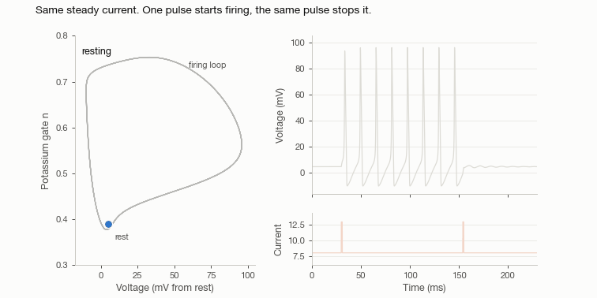
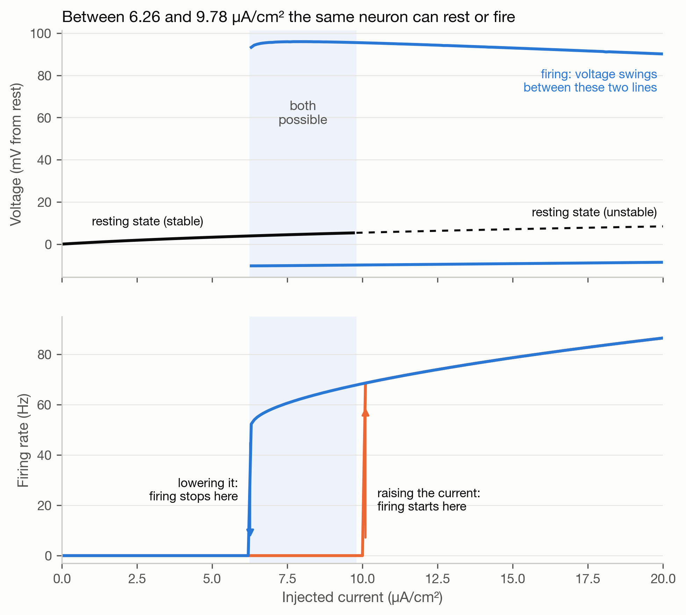
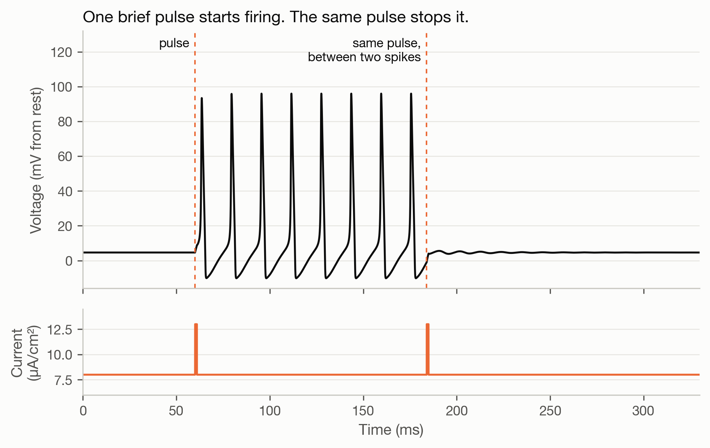
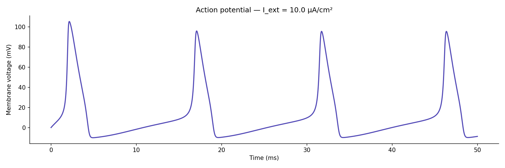

# Hodgkin-Huxley model

The 1952 squid-axon model in Python, used to look at where firing starts and where it stops.



With the injected current held at 8 µA/cm², the neuron sits at rest until a 1 ms pulse starts it firing. A second, identical pulse 8.65 ms after a spike stops it again: 0 spikes, then 8, then 0.

## Thresholds

| | µA/cm² | Method |
|---|---|---|
| One spike, then silence | 2.24 | step from rest, bisection |
| Sustained firing from a step | 6.26 | same, counting spikes after the first second |
| Firing dies out below | 6.264 | start in the firing state, lower the current |
| Rest becomes unstable above | 9.779 | Jacobian eigenvalues at the fixed point |

Between 6.26 and 9.78 both rest and firing are stable. Firing begins at about 52 Hz with no slow regime below it, and reaches 86 Hz at 20 µA/cm².



Sweeping the current up slowly from rest, firing started at 10.1; sweeping back down it lasted until 6.3. The 10.1 overshoots the eigenvalue result (9.779) because just past the threshold the resting state destabilises very slowly, so a sweep that waits 400 ms per step passes it before anything happens.




## Notes

An earlier README here gave the firing onset as 2.5 µA/cm². That number counted the few spikes the neuron fires when the current is first switched on. Between 2.24 and 6.26 it fires one to six spikes and goes quiet.

Firing rate is computed from the spacing between spikes. Two of the textbook rate functions are 0/0 at a single voltage each (V = 25 and V = 10 mV); the code uses the limit there.

This bistability is in the textbooks. The repo reproduces it and tests it.

## Running

```bash
pip install -r requirements.txt
pytest -q                           # 8 tests
python3 scripts/make_figures.py     # ~4 min, writes data/results.json
python3 scripts/make_animation.py
```

A MATLAB version of the basic model is in `matlab/hh_model.m`.

## Limits

Single compartment, original parameters at 6.3 °C, no noise. Voltages are relative to rest as in the 1952 paper. Many mammalian neurons start firing gradually, unlike this one.

Hodgkin & Huxley (1952), *J. Physiol.* 117, 500–544. MIT licence.
